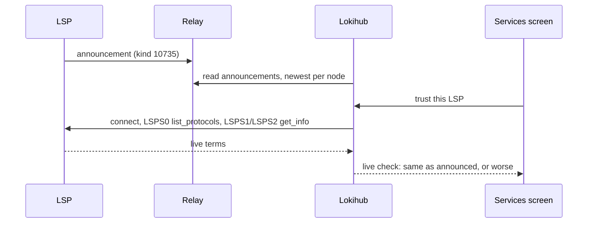

# Services: everywhere else Lokihub looks

A self-hosted Lightning wallet needs somewhere to get liquidity from, somewhere to check on-chain data,
somewhere to do swaps, relays to talk Nostr over. Services is the screen where the wallet owner points
all of that at whatever they trust — their own infrastructure, or one of Lokihub's suggested defaults.
Nothing here moves funds by itself; it's all "where do I look," never "what am I allowed to do."

## Why not just pick one provider

A single hard-coded LSP, or a single hard-coded relay, is a centralization point: what happens when that
provider shuts down or starts misbehaving? A wallet that can only talk to one specific server isn't
really self-hosted, it's hosted somewhere else. So every setting here is independently swappable, nothing
inherits from anything else, and a small built-in default list takes the edge off "which one do I pick"
for a new user.

## What's configurable

| Setting | What it's for |
|---|---|
| Main Nostr relay | where NIP-47 wallet-connect traffic actually flows |
| General relay list | everyday Nostr stuff |
| Search relay | profile and contact-list lookups (Circle Wallet's following checks) |
| LSP(s) | who you buy Lightning liquidity from, picked from their NIP-LSP announcements |
| Block explorer | on-chain data, mempool-style API |
| Swap service | on-chain ⇄ Lightning swaps |
| Messageboard relay (optional) | an experimental nostr-messageboard integration |
| Identity Authorities | who's trusted to vouch for a Cash Hub connection-key claim — see [NIP-CASH](https://github.com/ohstr/nips/blob/main/NIP-CASH.md) |

## Where the LSP list comes from

LSPs announce themselves: each publishes one NIP-LSP announcement (kind 10735), signed by its Lightning
node key, listing its addresses, the LSPS services it sells and their parameters. Lokihub reads these
announcements from its relays for its own chain and network, at most 200, and shows them unranked on the
Services screen. Nothing is trusted by default: you tick the LSPs you trust, and only those are ever
contacted or used. There is no built-in list and no `pubkey@host` input; you can add an LSP by its node
key, and its announcement supplies the rest.

An announcement only advertises. Its title, description and website are the LSP's own claims; the
Services screen shows the node id beside every title, marks two LSPs claiming the same name, and shows
whether the node is in your own node's view of the network. The newest announcement of each node is
remembered even when it fails a check, so a relay serving an older one cannot bring it back. A paused
LSP sells nothing new, and a closed one disappears from the list (existing channels stay). Before a
purchase the live LSPS answers decide: when they are worse than announced, Lokihub shows both and asks
again.

`services.json` still provides the rates, currencies, info and FAQ, but no LSPs.

## Where the trust actually lives

Most of the table above is low-stakes from a security standpoint. A relay, a block explorer, a swap URL —
none of them can move a sat on their own, since all they configure is where Lokihub *looks*, never what
it's *authorized to do*. Even LSP connections are just request/response protocols; an LSP has no
unilateral way to reach in and take funds.

The one row with real teeth is Identity Authorities. Trusting one means trusting it to vouch for who's
allowed to claim a slice out of a shared Cash Wallet — see [NIP-CASH](https://github.com/ohstr/nips/blob/main/NIP-CASH.md) for what that
hands a counterparty, and why revoking a bad Identity Authority has to take effect immediately, everywhere
it ever vouched for anyone.

## Related reading

- **[App Store](lokihub-appstore.md)** — same "small manifest, cached locally" mechanism, but for apps
  connecting *in* to the wallet rather than services it connects *out* to.
- **[NIP-CASH (Cash Hub)](https://github.com/ohstr/nips/blob/main/NIP-CASH.md)** — what the Identity Authority allowlist actually protects.
- **[Cash privacy](cash-privacy.md)** — what a Cash Hub's relays, and the Hub itself, can still see.
- **[JIT Payment](jit-payment.md)** — a different "JIT": the LSP row above is where that document's
  just-in-time channel buys get their LSP from.
- **[LSP Support](lokihub-lsp.md)** — the LSP `active` flag configured here is what every LSPS0/1/2/5 flow
  reads from.
